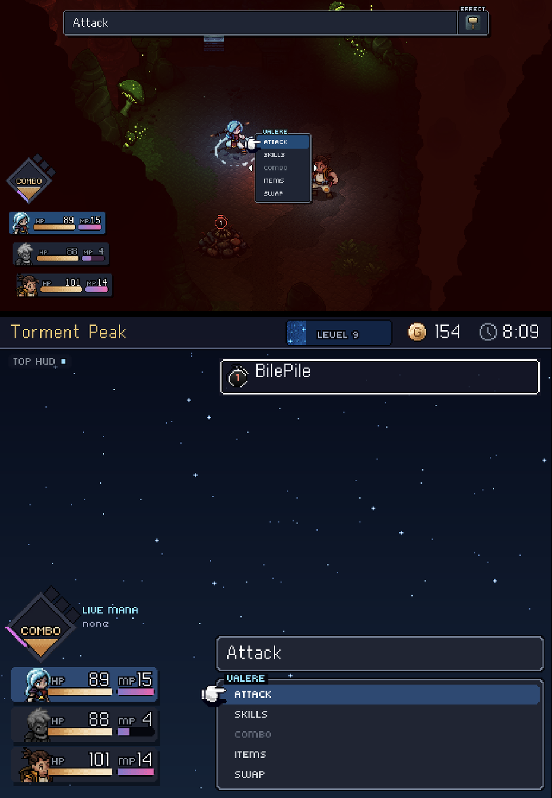
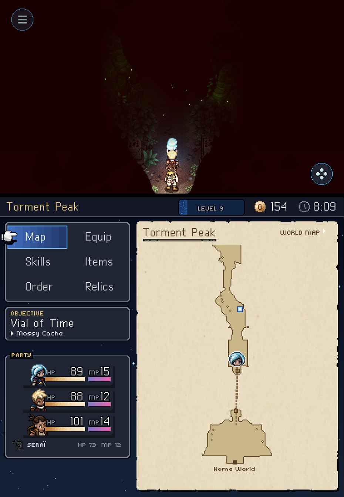
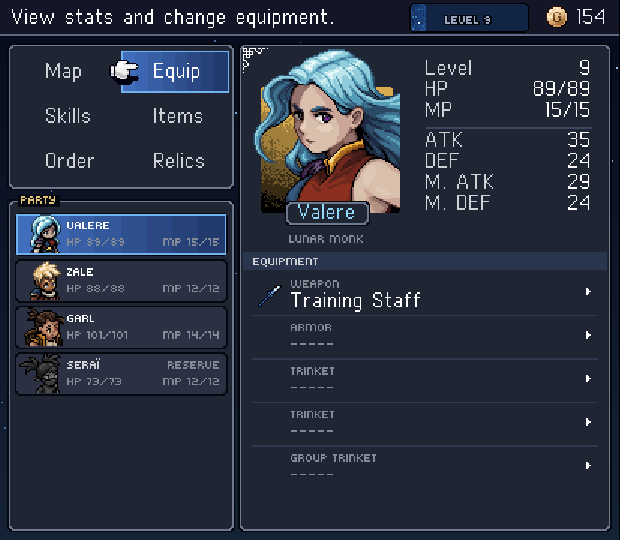
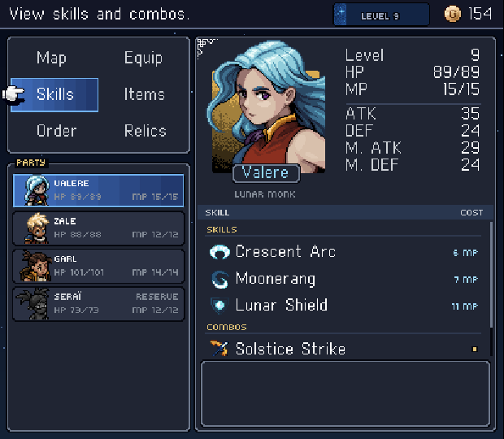
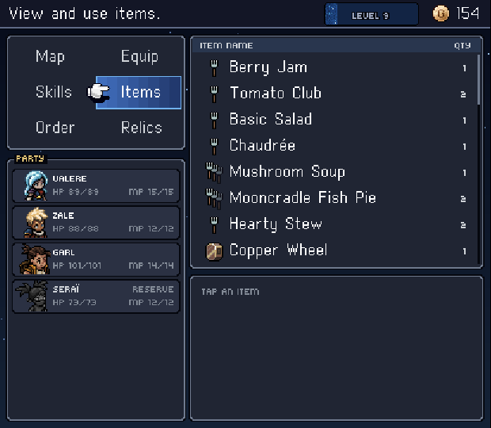
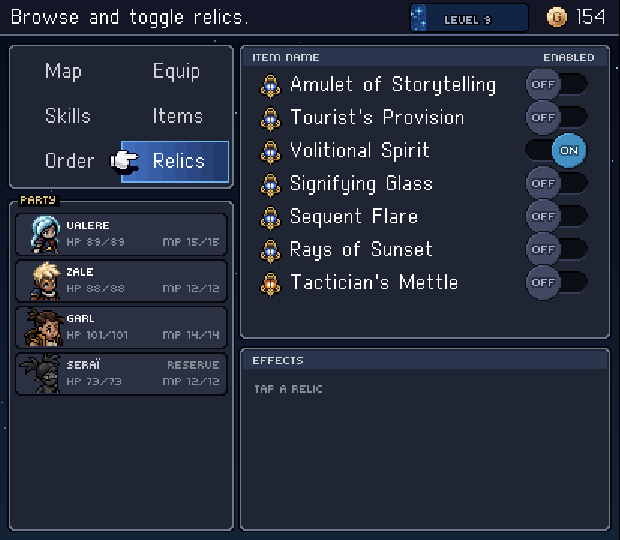

# Sea of Stars Duo

[](../../actions/workflows/build.yml)
[](../../releases)
[](LICENSE)

A dual-screen edition of **Sea of Stars** for Android handhelds with two screens, built on the
AYN Thor. The real game runs full screen on the top display. The bottom display becomes a second
game screen drawn in the game's own style: a battle board in fights, a map while exploring, and the
party menus a tap away.

Sea of Stars Duo **ships no game code or assets**. It loads the official Sea of Stars app you already
own from Google Play, runs it inside its own process, and draws the second screen with Android's
`Presentation` API. The fonts and pictures on the bottom screen are read from the running game on
your device. Your Google Play install is never modified.

| Battle | Exploration |
|---|---|
|  |  |

| Equip | Skills |
|---|---|
|  |  |

| Items | Relics |
|---|---|
|  |  |

## Requirements
- An Android device with two displays, where the second one is exposed to `Presentation`. The app was
  developed and tested on the AYN Thor only.
- Android 9 or newer, on an arm64 CPU.
- **Sea of Stars** from Google Play (`com.playdigious.seaofstars`), installed on the same device.
  This was developed against version 3.0.60158. Other builds should work because classes and fields
  are resolved by name at runtime, but they haven't been tested.

## Install
1. Install Sea of Stars from Google Play and launch it once, so its asset packs are in place.
2. Download `SeaOfStarsDuo-<version>.apk` from [Releases](../../releases), then install it by
   allowing unknown sources or with `adb install`.
3. Launch **Sea of Stars Duo** instead of Sea of Stars.

Saves are separate from the Google Play game's saves. To carry your progress over, copy the save
slots across (back them up first):

```sh
adb shell 'cp /sdcard/Android/data/com.playdigious.seaofstars/files/SOS_*.sos \
              /sdcard/Android/data/com.evtrai.sosduo/files/ && \
           chmod 660 /sdcard/Android/data/com.evtrai.sosduo/files/SOS_*.sos'
```

To update, install the new APK over the old one. If Android refuses because the signature changed,
back up the saves in `/sdcard/Android/data/com.evtrai.sosduo/files/` first: uninstalling removes them.

## Bottom screen

### In battle
- A card for each enemy with its turn countdown and its spell locks. Locks stay closed until the
  game itself reveals them, and the board lists which of your moves break the ones that are open.
- The game's info bar and instruction banner ("Hold A for power!").
- The command, skill and item lists. Tap an entry to pick it, or keep using the controller.
- Combo points, the ultimate gauge, Live Mana, and the party's HP and MP with the KO countdown.
- **TOP HUD**: a small switch that makes the top-screen HUD transparent for everything the bottom
  screen already shows, so the fight itself gets the whole top display.

### While exploring
- A chart of the area you are in, drawn from the level's walkable ground, with the party marker and
  the current objective.
- On the overworld, the island chart with the party marker. A button opens the game's own world map.
- The party's HP and MP at a glance.

### Menus
Equip, Skills, Items, Order and Relics open on the bottom screen while the game keeps running on
top: change gear, read skills and combos, eat food, swap party members and toggle relics. They are
available whenever the game would let you open its own menu, and every change goes through the
game's own functions, the same ones its menu calls. Nothing is written to the save behind the
game's back.

### Everywhere
The bottom screen shows only what the game has unlocked or revealed. During cutscenes, loading and
the title screen it steps out of the way.

## Controller prompts
Sea of Stars has no button pictures for some built-in pads (the AYN Thor reports as
"Odin Controller") and draws a "missing button" picture in its prompts. Sea of Stars Duo teaches
the game's glyph sheet those button names and uses the lettered A/B/X/Y set. To keep the game's
generic pictures instead, create an empty file `duo_nolettered.txt` in
`/sdcard/Android/data/com.evtrai.sosduo/files/`.

## Build from source
You need the Android SDK with NDK r27 (27.3.13750724) and CMake 3.31.6, plus JDK 17 (`JAVA_HOME`).

```sh
./gradlew assembleDebug
adb install -r app/build/outputs/apk/debug/app-debug.apk
```

Release builds read their signing key from `SOSDUO_KEYSTORE`, `SOSDUO_KEYSTORE_PASSWORD`,
`SOSDUO_KEY_ALIAS` and `SOSDUO_KEY_PASSWORD`. If these aren't set, the build is signed with the
debug key.

## Releases
GitHub Actions builds every push. Each push to `main` refreshes a rolling **Latest build**
pre-release. Pushing a `v*` tag creates a versioned release, and its notes come from
`docs/releases/v<version>.md`. For signed releases, set the repository secrets `KEYSTORE_BASE64`,
`KEYSTORE_PASSWORD`, `KEY_ALIAS` and `KEY_PASSWORD`.

## How it works
- `HostActivity` opens the installed game with `createPackageContext(CONTEXT_INCLUDE_CODE)`. It
  passes the game's class loader, assets, resources and native-library dir to Unity's `UnityPlayer`,
  then boots the engine inside this app's process. The manifest declares the Unity, Play Core and
  Firebase entries the game expects to find in its host, and turns off the game's analytics and
  crash reporting.
- `libsosduo.so` finds `libil2cpp.so` in memory and resolves the `il2cpp_*` exports from the
  library's own ELF symbol table. It reads game objects by class and field name, such as
  `CombatManager` → `currentEncounter` → enemies → `castingData`, and publishes a JSON snapshot
  several times a second. A hook on `InputManager.Update` gives it a slot on Unity's main thread
  for everything that must run there: reading sprites and fonts, building the area chart, and
  calling the game's own menu functions.
- `DuoView` (Java) draws the bottom screen from that snapshot, with the fonts and sprites cached
  from the running game in the app's own files folder.

[NOTES.md](NOTES.md) is the research record, covering class and field maps, startup fixes and pitfalls.
[TODO.md](TODO.md) lists what is still open.

## License
MIT, see [LICENSE](LICENSE). For notes on third-party software, see
[THIRD_PARTY_NOTICES.md](THIRD_PARTY_NOTICES.md).

## Disclaimer
*Sea of Stars* is the property of Sabotage Studio. The Android port is published by Playdigious.
This project is unofficial and isn't affiliated with or endorsed by either company. It includes no
game code, art or data. It loads the official Android game that you have installed and bought.
